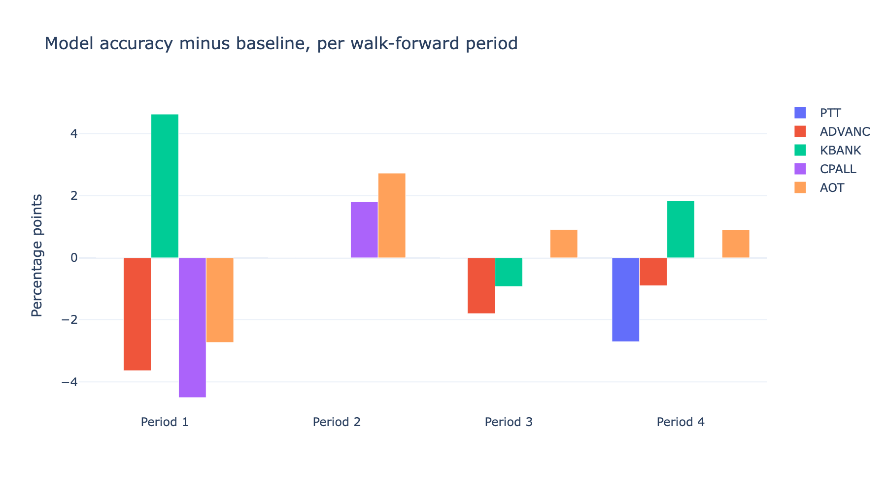
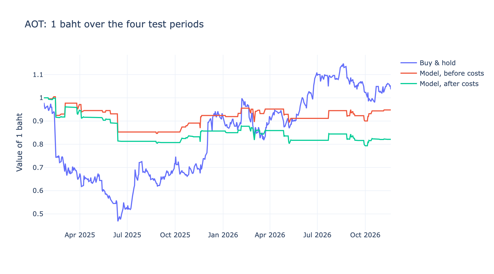

# Why my stock model didn't beat a coin flip

*An honest test of a machine-learning model on five large Thai stocks, and what it taught me about data
leakage and trading costs.*

I built a dashboard for Thai stocks: a screener for the SET100, a page per stock with its chart,
financials and valuation, and a portfolio tracker. One tab holds a small machine-learning model that
predicts whether a stock will close higher tomorrow. This article is about that tab, because the most
useful thing it ever told me was "no".

## The question

Can a simple model, fed only a stock's own recent prices and volume, guess tomorrow's direction better than
a trivial rule? And if it can, does that edge survive the cost of actually trading on it?

"Better" needs a yardstick. Up days and down days are not 50/50: over a given stretch a stock may close
higher on 45% of days and flat-or-lower on 55%. A model that always says "down" is then right 55% of the
time without knowing anything. That is the **baseline**: always guess whichever answer was more common in
the training data. A model is only interesting if it beats that, not if it beats 50%.

## The data and its limits

- **Prices:** daily open, high, low, close and volume from Yahoo Finance for five large SET50 stocks from
  different sectors: PTT (energy), ADVANC (telecom), KBANK (banking), CPALL (retail) and AOT (airports).
  Five years each, ending 21 November 2026.
- **Adjusted prices:** a dividend makes the price drop on the XD day without anyone losing money. Left in,
  every XD day looks like a crash. The dashboard stores prices as traded and back-adjusts them for dividends
  when reading (the same method as Yahoo's adjusted close), so a new dividend never leaves stored prices
  inconsistent.
- **Free data only:** no order book, no investor-type flows, no news. The model sees what any chart shows.

## The model

The target is simple: 1 if tomorrow's close is higher than today's, otherwise 0. Note that "flat" counts as
0. Thai prices move in fixed steps (a 37-baht stock moves in 0.25-baht ticks), so unchanged days are common,
which pushes the baseline above 50%. For PTT it was almost 61%.

The features are seven numbers per day, all computed from today and earlier:

- today's return and its 20-day volatility;
- the 14-day RSI;
- the change in volume;
- how far the close is from its 20- and 50-day moving averages, and how those averages sit against each
  other.

The model is a random forest (300 shallow trees). Nothing exotic: the point was the test, not the model.

## Data leakage: the easiest way to fool yourself

Data leakage means the model sees, during training, information it would not have had at the moment of the
prediction. Its test score then measures cheating, not skill. Stock data invites it in three ways.

**1. Random splits.** The default in most tutorials is to shuffle rows and hold out 20% for testing. With
time series that lets the model train on Wednesday and Friday and then "predict" Thursday. Neighbouring days
are similar, so the score looks great and means nothing. The fix is to split by time only: train on the past,
test on the future.

**2. Features that peek.** A centered moving average, or a feature filled backwards, quietly uses tomorrow.
The project has a test for this: it changes the last day's price and checks that no feature on any earlier
day changes. If one does, that feature looked into the future.

**3. The boundary.** This one is subtle. Each training row's answer is the *next* day's close. If the
training data ends on the day before the test starts, the last training answer is the first test day's
price. The fix is a one-day gap between the two. A test checks that, for every test window, the day after
the last training row is still before the window starts.

## Walk-forward testing

One train/test split gives one number, and one number can be luck: a model can look good just because the
test months happened to be a calm uptrend. So the newest 40% of the five years is cut into four consecutive
periods of about six months each. Each period is predicted by a model trained only on everything before it
(with the one-day gap). That is how the model would have been used for real: retrained as time moves on,
always predicting days it has never seen.

## Trading costs

The strategy is the obvious one: hold the stock tomorrow if the model says "up", otherwise hold cash. Every
switch is a trade, and every trade costs money. I used 0.17% per buy or sell, roughly a Thai online broker's
commission plus VAT, and ignored taxes and the bid/ask spread. That understates the real cost.

## Results

Data as of 21 November 2026; last 5 years per stock; 4 walk-forward periods covering the newest 40%; 0.17%
per buy or sell. Accuracies are averaged over the four periods. Strategy and buy & hold are the total return
over the same four periods.

| Stock | Model accuracy | Baseline accuracy | Model − baseline | Strategy (after costs) | Buy & hold | Trades |
|---|---|---|---|---|---|---|
| PTT | 60.2% | 60.9% | -0.7% | -2.1% | +38.4% | 5 |
| ADVANC | 53.7% | 55.3% | -1.6% | +0.4% | +33.5% | 40 |
| KBANK | 54.8% | 53.5% | +1.4% | +10.5% | +82.1% | 48 |
| CPALL | 58.6% | 59.3% | -0.7% | +20.0% | -7.1% | 48 |
| AOT | 56.0% | 55.6% | +0.5% | -17.9% | +3.6% | 84 |

Three of the five models were *less* accurate than always guessing the most common answer. The two that beat
it did so by 0.5 and 1.4 percentage points, the kind of gap that appears and disappears from one period to
the next:



Every stock has periods above and below zero. There is no stock where the model is reliably better.

The money side is clearer still. Buy & hold beat the model strategy on four of the five stocks. The one
exception, CPALL, is not skill: the stock fell, and a model that sits in cash most of the time loses less in
a falling market. PTT shows the other extreme: the model learned that "down or flat" is the most common answer
and almost never said "up", so it traded five times in two years and sat in cash while the stock rose 38%.

AOT shows what costs do. Before costs the strategy kept 95% of the money; after 84 trades at 0.17% it kept 82%:



## What I take from it

- **The baseline is the real opponent.** An accuracy of 58% sounds good until you see that "always down"
  scored 59% on the same days.
- **Daily direction is close to random** for these stocks, at least with features anyone can compute from a
  chart. That matches decades of research on liquid markets, and it is useful to see it in your own data.
- **Test like you would trade.** Splitting by time, leaving a gap, walking forward and charging costs each
  took away part of a result that looked fine at first.
- **Costs scale with activity.** A model with a tiny edge that trades often turns that edge into a loss.

The model stays in the dashboard as a lesson, not a signal. The tab says plainly whether it beat the baseline,
and for these stocks it usually did not. What I actually use for decisions are the parts that answer slower
questions: is the business growing, is the price cheap against its own history, and when is the next XD date.

## Reproduce it

Everything above comes from code in the repository:

```bash
.venv/bin/python scripts/update_data.py      # download the data into a local DuckDB file
.venv/bin/python scripts/report_backtest.py  # prints the table above for the stored date
```

`report_backtest.py` can also redraw both figures (`--figures docs/img`). With newer data the numbers will
change; the table states the date it was made for.

## Links

- Code: https://github.com/STeerajit/stock-dashboard
- Live app: https://stock-dashboard-pgq439mqsgzlcqf4w3s48m.streamlit.app

*For learning only. This is not investment advice.*
